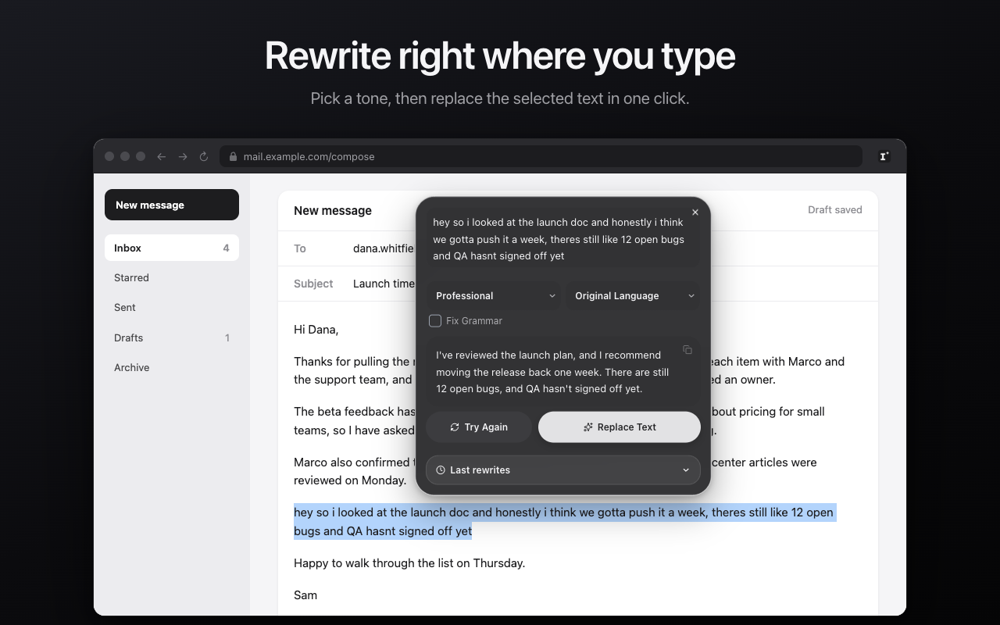

# Smart Translate & Rewrite

Rewrite selected text in 6 tones or translate it into 21 languages, right on the page. Free translation; rewriting uses your own AI key. No account, no backend, and nothing is sent until you click.




Website and setup guide: https://birkankervan.github.io/ai-text-rewriter/

## Features

- Rewrite in 6 tones: Professional, Friendly, Formal, Casual, Concise, Expanded
- Optional Fix Grammar pass for spelling, punctuation and grammar
- Rewrite and translate in one step: keep the original language or rewrite into another
- Replace Text puts the result back into inputs, text areas and rich-text editors
- Translate selected page text into 21 languages with automatic source-language detection
- Results stream in as they are written; stop a request at any time
- Toolbar popup with separate Rewrite and Translate tabs for text that isn't on a page
- History of rewrites and translations with search, filters, copy and delete
- Light, dark or system appearance, plus an optional pure-black mode

AI providers (bring your own key): OpenRouter, OpenAI, Google Gemini, Groq. The model list loads from the provider. Free translation uses Google Translate and needs no key.

## Install

**From a release:** download `chrome-mv3-prod.zip` from the [latest release](https://github.com/birkankervan/ai-text-rewriter/releases/latest), unzip it, open `chrome://extensions`, turn on Developer mode, and click **Load unpacked**.

**From source** (Node.js 18+ and pnpm):

```bash
pnpm install
pnpm dev        # watch build in build/chrome-mv3-dev, load it unpacked
pnpm build      # production build in build/chrome-mv3-prod
pnpm typecheck
```

## Setup

Translation works right after install. To rewrite, open **Settings** from the popup, pick a provider card under **AI provider**, paste your key, click **Connect**, and choose a model. To translate with your AI provider instead of Google Translate, change **Languages → Translation engine**.

Full walkthrough and troubleshooting: [Setup guide](https://birkankervan.github.io/ai-text-rewriter/setup.html).

## Privacy

- Selecting text sends nothing. A request starts only after you click.
- No backend, no account, no analytics. The extension talks directly to the service you chose.
- Rewrites and AI translations go to your AI provider with your key; free translation goes to Google Translate.
- API keys and settings stay in `chrome.storage.local` on this device and are not synced.
- History stays in your browser and is deleted automatically after 15 days.

Details: [Privacy policy](docs/PRIVACY_POLICY.md).

## Project structure

| Path | What it holds |
|---|---|
| `src/services/llm.ts` | Provider requests and stream parsing |
| `src/services/translation-gateway.ts` | AI / free translation routing |
| `src/hooks/use-stream.ts` | Request lifecycle, cancellation, history writes |
| `src/content.tsx` | In-page selection and replacement flow |
| `src/features/` | Popup, modal, options and history UI |
| `docs/` | GitHub Pages site, setup guide, privacy policy |
| `store-assets/` | Icon, screenshots and promo images |

## Contributing

Planned work lives in [`work-tracking/ROADMAP.md`](work-tracking/ROADMAP.md); see [`AGENTS.md`](AGENTS.md) for project rules. Run `pnpm typecheck` and `pnpm build` before opening a pull request.
